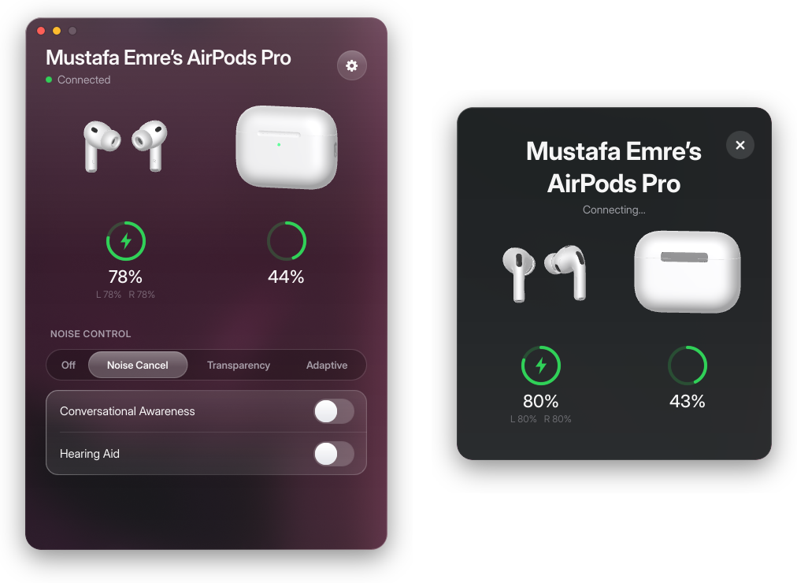
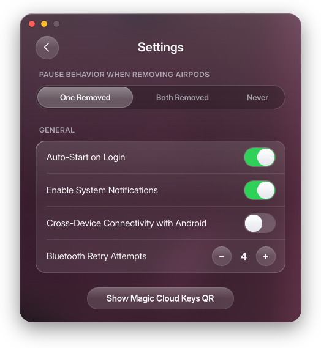

<div align="center">

# RiasPods

**AirPods control for Linux, with a liquid-glass UI, a live 3D model and an iPhone-style connect card.**

Built for AirPods Pro 3 on Arch Linux and Hyprland. Based on [LibrePods](https://github.com/kavishdevar/librepods).




</div>

## What it does

**Open the case, and it connects.** RiasPods listens for the AirPods' Bluetooth
advertisements. A closed case is silent, so when the AirPods start advertising again
it knows the lid was opened. The connect card slides up straight away with the battery
levels, and if the AirPods aren't connected to anything else they are called at once.
The Bluetooth link is usually up within a second.

**Everything an iPhone shows you**
- Battery for each bud and the case, with charging state. The case level is remembered
  while it's closed ("2 h ago").
- Noise control: Off, Noise Cancellation, Transparency, Adaptive
- Conversational Awareness, Hearing Aid, One Bud ANC
- Ear detection: pauses playback when you take a bud out, and moves the audio back to
  the AirPods when you put them in
- Media keys on the AirPods (via `mpris-proxy`)

**Made to look good and stay light**
- A real-time 3D model of the buds and case (Qt Quick 3D), with glass panels and
  macOS-style window lights
- The 3D view only draws while it's moving and is capped at 60 fps, even on a 240 Hz
  screen. Hidden in the tray it uses no CPU.
- After the first time, the window opens in about 20–80 ms

## Screenshots

<table>
  <tr>
    <td align="center"><br><sub>Connect card, shown as the lid opens</sub></td>
    <td align="center"><br><sub>Settings</sub></td>
  </tr>
</table>

## Install (Arch Linux)

```sh
git clone https://github.com/mstfemre/riaspods.git
cd riaspods
makepkg -si
```

Dependencies: `qt6-base`, `qt6-declarative`, `qt6-quick3d`, `qt6-connectivity`,
`libpulse`, `openssl`. Building also needs `cmake` and `qt6-tools`. `inter-font` is
optional, for Apple-like typography.

Pair the AirPods once with `bluetoothctl` or your Bluetooth settings, then start RiasPods.
On the first connection it gets the AirPods' encryption keys by itself; those keys are
what let it read the battery and lid state from the advertisements.

## Usage

| Command | |
|---|---|
| `riaspods` | Open the window (or bring the running instance to the front) |
| `riaspods --hide` | Start in the tray. Autostart (Settings → *Auto-Start on Login*) uses this. |
| `riaspods --debug` | Log every packet to the journal |
| `riaspods-ctl noise:anc` | Also `noise:off`, `noise:transparency`, `noise:adaptive`. Handy for keybindings. |

For play/pause and skip on the AirPods themselves, enable BlueZ's MPRIS proxy:

```sh
systemctl --user enable --now mpris-proxy.service
```

### Hyprland

The app draws its own title bar, so it looks best floating with no window decorations.
Example rules for a Lua config:

```lua
hl.window_rule({
  match = { class = "^riaspods$", title = "^RiasPods$" },
  float = true, size = "460 676", center = true, rounding = 20, border_size = 0,
})
hl.window_rule({
  match = { class = "^riaspods$", title = "^RiasPods Connect$" },
  float = true, pin = true, no_initial_focus = true, size = "400 448",
  move = "monitor_w*0.5-window_w*0.5 monitor_h-window_h-64",
  rounding = 20, border_size = 0, no_shadow = true, no_anim = true,
})
```

The windows are translucent; turn on blur in Hyprland for the glass look.

## Troubleshooting

- **Logs:** `journalctl -b _COMM=riaspods -f`. Start with `--debug` for packet-level detail.
- **Opening the lid doesn't connect:** the scan only runs while the AirPods are
  disconnected, so `bluetoothctl show` should say `Discovering: yes` at that point. If
  the Bluetooth controller resets, RiasPods restarts the scan by itself.
- **No sound after connecting:** RiasPods switches the card to A2DP. If the audio device
  doesn't appear, it asks BlueZ once to reconnect the profile.

## Project layout

```
PKGBUILD            Arch package
librepods/linux/    the app: C++ / Qt Quick / Qt Quick 3D
  main.cpp          AirPods protocol, Bluetooth, lid-open connect
  ble/              advertisement scanning and decoding
  media/            ear detection, A2DP and playback control
  *.qml             the glass UI and the 3D turntable
model/              source 3D model and converted meshes
docs/screenshots/   README images
```

## Credits and assets

- **LibrePods** (https://github.com/kavishdevar/librepods) by Kavish Devar, GPL-3.0.
  RiasPods is a modified version of its Linux app and stays under the same licence.
- **3D model:** "AirPods Pro 3"
  (https://sketchfab.com/3d-models/airpods-pro-3-2209c17723a54331985cc080eda35266)
  by Apple User (https://sketchfab.com/apple-user), licence: Sketchfab Standard
  (https://sketchfab.com/licenses). Changes: converted to Qt Quick 3D meshes, materials
  adjusted. The model is **not** covered by this repository's GPL-3.0 licence; all rights
  stay with its author. It will be removed on the author's request.
- AirPods is a trademark of Apple Inc. This project is not affiliated with Apple.
